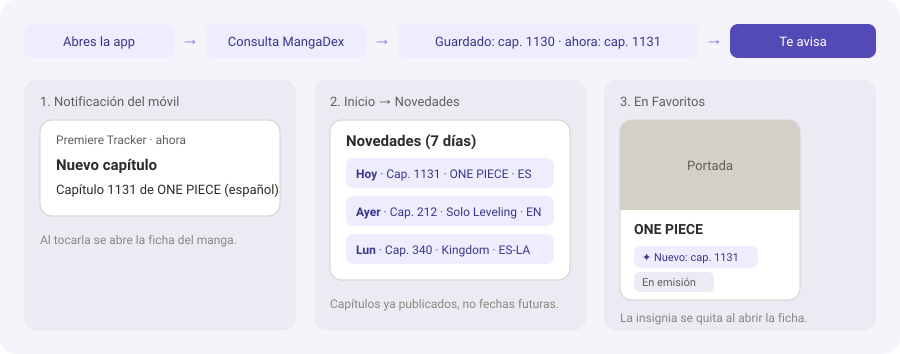

<p align="center">
  
</p>

<h1 align="center">Premiere Tracker</h1>

Aplicación multiplataforma para Windows y Android desarrollada con Flutter y Dart en Android Studio. Sirve para buscar películas, series y personas, ver cuándo se estrenan las películas y cuándo salen las temporadas y los episodios de las series (incluidas las que emiten semana a semana), buscar mangas, manhwas, manhuas y novelas con su ficha y sus últimos capítulos, y llevar un seguimiento personal: favoritos, vistos/leídos y notas de dónde se dejó cada cosa.

## Antes de instalar

> [!IMPORTANT]
> **Windows (unos 30 MB):** copia la **carpeta `Release` completa** (el `.exe`, los `.dll` y la carpeta `data`), no solo el `.exe`. Si al abrirla no arranca o dice que falta `MSVCP140.dll` / `VCRUNTIME140.dll`, instala el **Microsoft Visual C++ Redistributable (x64)**, gratuito y oficial de Microsoft: [descargar vc_redist.x64.exe](https://aka.ms/vs/17/release/vc_redist.x64.exe). La mayoría de PCs ya lo tienen.
>
> **Android (APK de unos 54 MB):** el APK normal es **universal**, vale para cualquier móvil porque lleva la app para los tres tipos de procesador (64 bits, 32 bits y x86_64). Para un APK más ligero (unos 19 MB) compila uno por procesador con `flutter build apk --release --split-per-abi`: para los móviles de los últimos años el que vale es el **`arm64-v8a`**.
>
> En los dos casos la primera vez hay que poner **tu propia clave de TMDB** en la pantalla de usuarios (la app no lleva ninguna).

## Funcionalidades

- **Usuarios locales con PIN**: cada usuario tiene su propio perfil con un PIN de 4 dígitos cifrado con SHA-256 (nunca en texto plano) y sus propios favoritos, vistos, notas, tema e idioma. Se entra automáticamente al escribir los 4 dígitos; si el PIN está mal se avisa y se limpia el campo, y **tras dos fallos aparece una pista con los dos primeros dígitos**. Desde el propio diálogo de acceso también se puede **cambiar el PIN** (validando antes el actual). El tema elegido se recuerda también en la pantalla de usuarios.
- **Clave TMDB configurable**: la clave de TMDB se introduce desde la propia app (pantalla de usuarios → «Clave TMDB», con botón para obtenerla) y se guarda en el dispositivo; por eso las versiones compiladas (`.exe` y APK) **no llevan ninguna clave embebida** y cada persona usa la suya.
- **Búsqueda global anti-fallos**: una sola caja busca **series, películas y personas a la vez** (en paralelo, con tiempos de espera de 10 s). Si una API falla, la otra sigue funcionando y se muestra un aviso claro; si fallan las dos, se avisa de "Sin conexión o servicios no disponibles". Los resultados aparecen en tarjetas con botones de favorito ❤️ y visto 👁️ (en el móvil en vertical, de dos en dos).
- **Próximamente**: en Inicio, mientras no se busca nada, aparecen los estrenos de tus favoritos de hoy a 6 días vista (episodios y películas), y al pulsarlos se abre su ficha.
- **Avisos de estreno**:
  - **Android**: notificación del móvil a las 10:00 del día de cada estreno de tus favoritos («Hoy sale el episodio T1E4 de …»), aunque la app esté cerrada. Se reprograman al abrir la app.
  - **Windows**: mientras la app está abierta, al entrar y cada hora avisa de los estrenos de hoy de tus favoritos y de lo que está en emisión o planeado, una sola vez por estreno.
  - Se activan o desactivan en **Ajustes → Notificaciones de estreno** (activadas por defecto).
- **Selector de fuente TMDB | TVMaze**: en las series se puede cambiar entre las dos fuentes; se enlazan entre sí mediante el ID de IMDb. Si una fuente no está disponible, su opción queda desactivada.
- **Detalle de series y películas**: póster, sinopsis, estado (en emisión, finalizada, cancelada...), fecha de estreno con **cuenta atrás** («· en 3 días»), **géneros y palabras clave pulsables**, puntuación, temporadas desplegables con sus episodios (número, título y fecha), el próximo episodio destacado, **dónde verlo** en España (plataformas de streaming con su logo; datos de JustWatch vía TMDB), el **reparto con cada actor pulsable** (abre su ficha) y **recomendaciones** de TMDB («¿Te gustó esto? También te puede gustar», también con la fuente TVMaze) con la **nota media y una estrella**. Al final, botones para **ver la ficha en TMDB y en TVMaze**. En las películas se usa la **fecha de estreno en España** y, si se estrenó antes en otro país, se muestra también el **primer estreno mundial**. Incluye los botones "Añadir a favoritos" y "Añadir a vistos" (en el móvil en vertical, uno al lado del otro) y, si está guardada, **tu nota personal de 1 a 10**.
- **Explorar por género y palabra clave**: en cualquier ficha, al tocar un género (Acción, Romance...) o una palabra clave (#slice of life...) se abre una pantalla con los títulos más populares que la tienen, del mismo tipo: series y películas desde TMDB, y mangas o novelas desde AniList (con sus etiquetas). Las fichas de TVMaze solo tienen géneros, porque TVMaze no da palabras clave.
- **Fichas de persona**: foto, biografía y créditos (series y películas en las que ha participado), con enlaces a las webs de las APIs y botón para **guardarla en Favoritos**.
- **Lectura (mangas, manhwas, manhuas y novelas)**: buscador sobre AniList con dos pestañas — **Manga / Manhwa / Manhua** y **Novelas** — lanzando las dos búsquedas en paralelo con una sola escritura. La ficha incluye portada, estado (con capítulos y tomos marcados como «?» si aún no hay total), puntuación, formato, país, fecha de inicio, **autores**, géneros y etiquetas pulsables, **sinopsis en español** cuando MangaDex la tiene (si no, la de AniList), con su **fuente** siempre debajo y el **último capítulo publicado por idioma** (español de España, español latino e inglés) consultado a MangaDex con límite de peticiones y caché. Tiene botones de **favorito** y **marcar como leído**, tu nota personal y enlaces a AniList y MangaDex; los mangas guardados se abren desde Favoritos/Vistos recargando la ficha completa desde AniList.
- **Calendario** con cuatro vistas y pestañas Series / Películas (solo de tus favoritos):
  - **Día** y **Semana**: flechas para cambiar de periodo y botón morado "Hoy". En Windows, las series van en rejilla por horas y las películas sin horas (lista en Día y siete columnas en Semana); en Android, lista de estrenos por día (con su hora), legible en vertical y en horizontal.
  - **Mes**: rejilla con los estrenos de cada día (en el móvil, solo cuántos hay; al tocar el día se abre su lista), y selector de mes y año (de 2 años atrás a 6 años adelante).
  - **Año**: rejilla de los 12 meses con el número de estrenos de cada uno; al pulsar un mes se abre su vista Mes.
  - Los datos se cargan solo del periodo visible, en paralelo y respetando el límite de peticiones de TVMaze (20 cada 10 segundos, con caché en memoria que comparten el calendario y Próximamente).
- **Favoritos**: lista con buscador por nombre y filtro Todo / Series / Películas / Manga / Manhwa / Manhua / Novelas / **Personas**, con **cuántos hay** de cada tipo entre paréntesis; en el móvil se pasa de un tipo a otro **deslizando** y la barra de arriba se mueve a la vez. Cada tarjeta muestra el **estado** que da la base de datos (En emisión, En espera, Abandonado, Planeado o Finalizado), tu nota y la cuenta atrás si aún no se ha estrenado («Estrena en 3 días», «¡Hoy estrena!»). Filtro por estado y orden por el de añadido o por tu nota; en Personas, por el de añadido o alfabético.
- **Vistos**: misma búsqueda, filtros y orden que favoritos (sin Personas), con el botón 👁️ para apuntar qué ya has visto (para los mangas se usa como **leídos**).
- **Notas**: tabla de tres columnas (**Título | Última vista | Más datos**) para recordar dónde se dejó cada serie o película; solo el título es obligatorio, con buscador, edición y borrado; las notas recientes aparecen primero.
- **Ajustes**: idioma (español / inglés), tema (claro / oscuro; oscuro por defecto), notificaciones de estreno, copia de seguridad (exportar e importar **favoritos, vistos y notas** a un `.json` —incluidos mangas, novelas, personas, estados y notas personales—, compatible con copias antiguas), gestión de usuarios (cambiar nombre, cambiar PIN y borrar usuario) y créditos.
- **Interfaz**: navegación lateral fija en Windows e inferior en móvil (Inicio, Lectura, Calendario, Favoritos, Vistos, Notas y Ajustes), barra superior con interruptor de tema y menú de usuario, diseño Material 3 con tema claro y oscuro adaptable al redimensionar (vertical y horizontal), y en Windows la ventana **arranca maximizada**.

## Tecnologías

- **Flutter / Dart** (Windows y Android)
- **provider** – estado global (MVC con `ChangeNotifier`)
- **http** – peticiones a las APIs
- **shared_preferences** – almacenamiento local en formato JSON
- **crypto** – cifrado SHA-256 de los PIN
- **file_picker** – exportar / importar copias de seguridad
- **url_launcher** – enlaces a las webs de las APIs y a "dónde verlo"
- **flutter_local_notifications** + **timezone** – avisos de estreno (Android y Windows)
- **calendar_view** (fijado a 2.0.0) – rejilla por horas de Día y Semana en Windows (el resto de vistas son propias)

## APIs usadas

- **TMDB** (https://api.themoviedb.org/3): películas, series y personas. Requiere API key.
- **TVMaze** (https://api.tvmaze.com): solo series, sin API key. Límite de unas 20 peticiones cada 10 segundos; la app respeta ese límite y guarda resultados en caché.
- **AniList** (https://graphql.anilist.co): mangas, manhwas, manhuas y novelas, sin API key.
- **MangaDex** (https://api.mangadex.org): últimos capítulos por idioma y sinopsis en español, sin API key. Límite de 5 peticiones por segundo; la app lo respeta y guarda resultados en caché.

## Arquitectura (MVC)

La app sigue el patrón Modelo-Vista-Controlador:

```
lib/
  main.dart            → Punto de entrada y temas
  l10n/                → Textos por idioma (español e inglés)
  models/              → Clases de datos con fromJson y toJson
  services/            → Conexión con APIs, almacenamiento local y copia de seguridad
  controllers/         → Lógica de cada pantalla (ChangeNotifier + provider)
  views/               → Pantallas (solo muestran datos y llaman al controlador)
    widgets/           → Widgets reutilizables sin lógica propia
assets/images/         → Logo de TMDB y demás imágenes
assets/icon/           → Icono de la app (para este README)
```

Cada vista tiene su controlador con el mismo nombre (`usuarios_view.dart` ↔ `usuarios_controller.dart`, etc.), más el `app_controller.dart` para el estado global (usuario actual, tema, idioma, favoritos, vistos y notas).

## Cómo ejecutarlo

1. **Consigue tu API key de TMDB** (gratis):
   - Crea una cuenta en https://www.themoviedb.org/
   - Ve a *Settings → API* y solicita una clave (tipo "Developer").
2. **Instala las dependencias**:
   ```bash
   flutter pub get
   ```
3. **Ejecuta la app**:
   ```bash
   flutter run -d windows
   ```
   (En Android, con el móvil conectado: `flutter run -d android`.)
4. **Introduce tu clave TMDB en la app**: en la pantalla de usuarios, sección «Clave TMDB» (hay un botón para obtenerla si aún no la tienes). Se guarda en el dispositivo y ya no hace falta configurar nada más.

   > Nota: para compilar en Windows puede ser necesario activar el *Modo de desarrollador* de Windows (*Configuración → Sistema → Para programadores*).

Si la API key falta o es incorrecta, la app muestra un aviso claro en lugar de cerrarse.

## Cómo compilar el .exe

```bash
flutter clean
flutter pub get
flutter build windows --release
```

El ejecutable se genera en:

```
build\windows\x64\runner\Release\premiere_tracker.exe
```

(El nombre visible de la ventana, «Premiere Tracker», se cambia en `windows/runner/main.cpp`; no se debe renombrar el `.exe` con `OUTPUT_NAME` en CMake, porque `flutter run` y el botón ▶ de Android Studio buscan `premiere_tracker.exe`.)

Para usar la app en otro ordenador hay que copiar la **carpeta completa `Release`** (el `.exe`, los archivos `.dll` y la carpeta `data`), no solo el `.exe`. Si en ese PC no arranca, falta el Visual C++ Redistributable (ver [Antes de instalar](#antes-de-instalar)).

## Cómo compilar el APK (Android)

```bash
flutter clean
flutter pub get
flutter build apk --release
```

El APK se genera en:

```
build\app\outputs\apk\release\Premiere-Tracker.apk
```

Se instala en el móvil copiando el archivo o con `flutter install`.

Para un APK más ligero, uno por tipo de procesador (ver [Antes de instalar](#antes-de-instalar)):

```bash
flutter build apk --release --split-per-abi
```

Para los móviles actuales se usa el que lleva `arm64-v8a` en el nombre.

**El APK no lleva ninguna clave TMDB embebida**: cada persona que lo instale debe introducir su propia clave en la app (pantalla de usuarios → «Clave TMDB»).

## Pruebas

- **Tests unitarios** (datos, copias de seguridad, estados, fechas, avisos...):
  ```bash
  flutter test
  ```
- **Prueba de integración**: recorre la app entera como lo haría una persona (usuarios, notas, calendario, búsqueda, favoritos, personas, ajustes...). No toca los datos reales del equipo.
  ```bash
  flutter test integration_test/recorrido_app_test.dart -d windows
  ```
  En el móvil se usa el id del dispositivo en lugar de `windows` (ojo: al terminar, `flutter test` desinstala la app del móvil y se pierden sus datos). Opcionalmente, `--dart-define=TMDB_KEY=<tu clave>` prueba también TMDB y `--dart-define=HORIZONTAL=true` gira la app a horizontal.

## Icono de la app

En Windows, el icono (exe y barra de títulos) sale de `windows/runner/resources/app_icon.ico`. Para cambiarlo, sustituye ese archivo por un `.ico` multiresolución (16–256 px) y vuelve a compilar. En Android, el icono se genera con flutter_launcher_icons a partir de `tool/app_icon_256.png`. Si el Explorador de Windows se queda con el icono antiguo, refresca su caché con:

```bash
ie4uinit -show
```

## Ideas para el futuro

Ideas pensadas pero no implementadas. Si alguien las quiere, se pueden añadir.

### Avisos de capítulos nuevos de mangas

La ficha de cada manga ya muestra el último capítulo publicado en tres idiomas (español de España, latino e inglés), así que para saber si hay uno nuevo basta con abrirla. La idea sería que la app lo avisara sola:



- **Cómo funcionaría:** la app apunta, para cada manga de Favoritos, el último capítulo que conoce en cada idioma. Al abrirla (y en Windows también cada hora, como los avisos de estreno) pregunta a MangaDex; si hay un número mayor, es un capítulo nuevo.
- **Cómo se vería:** una notificación («Capítulo 1131 de ONE PIECE (español)»), una lista de **Novedades** en Inicio con lo publicado estos días y una insignia «Nuevo» en la tarjeta de Favoritos. Se podría elegir solo una o dos de las tres.
- **Límites:** solo avisa de capítulos **ya publicados**, no de cuándo saldrá el siguiente (ni MangaDex ni AniList dan fechas futuras de manga). Con la app cerrada no comprueba nada, así que en el móvil el aviso llega al abrirla. Y depende de que MangaDex tenga ese manga en ese idioma.
- **Coste:** poco código y ninguna clave nueva, reutiliza los datos de MangaDex que la ficha ya usa.

## Créditos

- Este producto usa la API de TMDB pero no está respaldado ni certificado por TMDB.
- Datos de series proporcionados por [TVMaze](https://www.tvmaze.com).
- Datos de mangas, manhwas, manhuas y novelas proporcionados por [AniList](https://anilist.co) y [MangaDex](https://mangadex.org).

## Licencia

Copyright (c) 2026 peter1323. Todos los derechos reservados.

Este código es público solo para consulta. No está permitido copiarlo, modificarlo, distribuirlo ni usarlo en proyectos propios, ya sea total o parcialmente, sin permiso expreso del autor.

Consulta el archivo [LICENSE](LICENSE).
